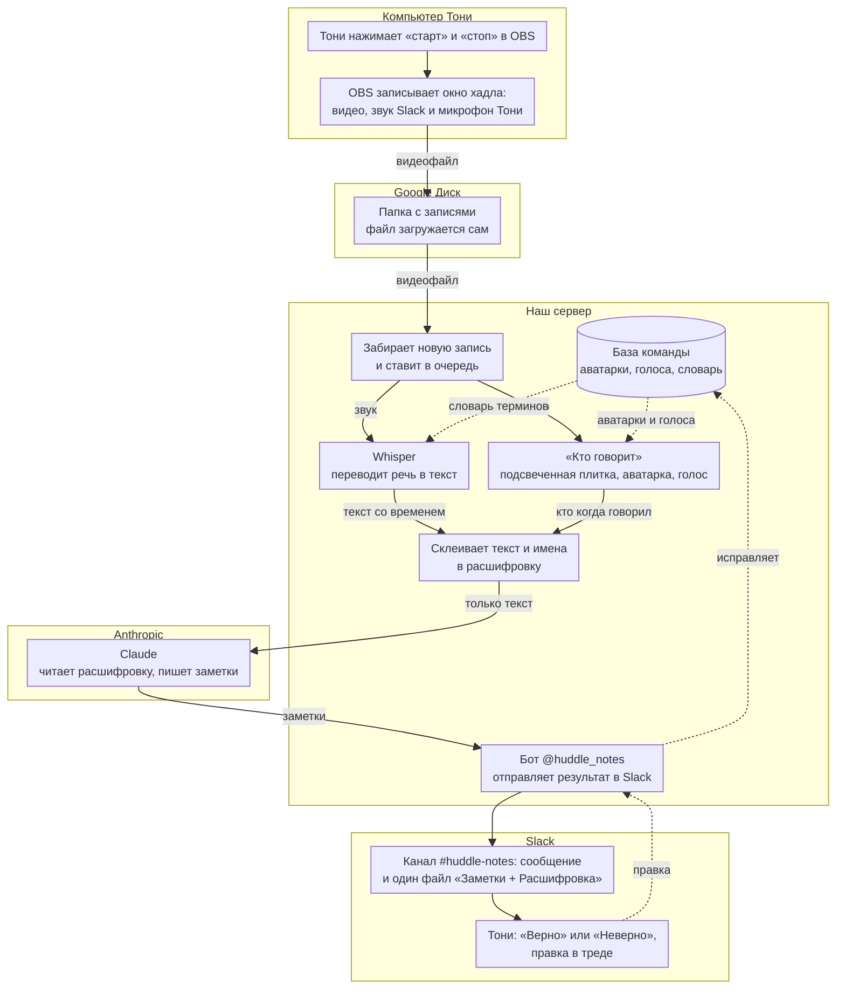

# Заметки хадлов

Записываешь звонок в Slack (хадл) — через ~20 минут в канале `#huddle-notes` появляется
**один файл**: сначала заметки (о чём говорили, что решили, кто что делает), потом полная
расшифровка, где у каждой реплики стоит имя говорящего. Как Gemini Notes, только на русском.

> **Что уже работает.** Расшифровка с именами: проверена на двух настоящих звонках.
> **В работе:** сервер, заметки от Claude и бот в Slack. Пока звонок обрабатывается вручную.

## Что нужно сделать тебе

1. Перед звонком нажать **«Начать запись»** в OBS.
2. После звонка нажать **«Остановить запись»**.

Всё. Запись сама уйдёт на обработку, результат придёт в `#huddle-notes`.

## Как это работает



| Шаг | Кто делает | Что происходит |
|---|---|---|
| Запись | OBS на компьютере Тони | записывает окно хадла: картинку, звук собеседников и микрофон Тони |
| Доставка | Google Диск | сам загружает готовый файл в общую папку; если пропал интернет — догрузит позже |
| Очередь | наш сервер | замечает новую запись, забирает её и удаляет с Диска, чтобы он не заполнялся |
| Текст | Whisper | переводит речь в текст и помечает, когда сказано каждое слово |
| Кто говорит | наш код | смотрит, чья плитка подсвечена, узнаёт человека по аватарке, проверяет по голосу |
| Заметки | Claude | читает расшифровку и пишет краткое содержание, решения и следующие шаги |
| Результат | бот `@huddle_notes` | присылает в `#huddle-notes` сообщение и один файл |
| Исправления | ты | «Неверно» или ответ в треде, например «в 18:30 говорил Петя», — бот запомнит |

### Как узнаются люди

Slack подсвечивает плитку того, кто говорит. Мы находим эту плитку на видео и узнаём
человека **по аватарке** — где бы плитка ни стояла. Там, где плитки не видно (кто-то
показывает экран, окно было свёрнуто), человека узнаём **по голосу**. Если признаки
расходятся или их не хватает, ставим **«?»**: лучше честный вопрос, чем чужое имя.

Новых людей система не знает. В первый раз их нужно назвать, дальше узнает сама.

## Что придёт в Slack

Сообщение в `#huddle-notes`:

> **Планёрка: загрузки на понедельник, Трактор, Импульс**
> 5 ноября 2026, 10:01 · 45 мин · #староста
> Краткое содержание в 3–4 предложениях и список следующих шагов.
> 📎 `2026-11-05 10-01.md` · кнопки **Верно** / **Неверно**

Файл внутри устроен так:

```
# Звонок 5 ноября 2026, 10:01
5 ноября 2026, 10:01 · 45 мин · Участники: Тони, Катя, Маша, Петя…

## Заметки
Краткое содержание, подробности по темам со ссылками на время, следующие шаги — кто что делает

## Расшифровка
[00:00:00] Тони: Ну что, начнём…
[00:00:12] Катя: …
```

## Какие модели работают

| Задача | Модель | Где работает |
|---|---|---|
| Речь → текст | Whisper **large-v3-turbo** | на нашем сервере, звук никуда не уходит |
| Голоса | **wespeaker ResNet34** | на нашем сервере |
| Заметки | Claude **Opus 5.5** | у Anthropic, через общий аккаунт компании; уходит только текст |

Модели выбираются в одном месте — в файле настроек `.env` на сервере:

```
HUDDLE_WHISPER_MODEL=large-v3-turbo
HUDDLE_VOICE_MODEL=wespeaker-resnet34
HUDDLE_NOTES_MODEL=claude-opus-5-5
```

Какие ещё есть варианты и скачаны ли они, показывает команда `huddle-notes models`.

## Данные и безопасность

- **Видео и звук не покидают наш сервер.** В Anthropic уходит только текст расшифровки.
- Записи хранятся на сервере **7 дней**, потом удаляются. Заметки и расшифровки остаются в Slack.
- Канал `#huddle-notes` закрытый.
- **Голоса — это биометрия.** Отпечатки голосов хранятся только на сервере, никогда не
  попадают в этот репозиторий, и на них нужно согласие участников звонков.
- Ни записи, ни имена, ни токены доступа в репозитории не лежат.

## Для разработчиков

Как устроен код, как запустить, проверить и выложить новую версию —
в [docs/development.md](docs/development.md).
