# Заметки хадлов

Записываешь звонок в Slack (хадл) — через ~20 минут в канале `#huddle-notes` появляется
**один файл**: сначала заметки (о чём говорили, что решили, кто что делает), потом полная
расшифровка, где у каждой реплики стоит имя говорящего. Как Gemini Notes, только на русском.

> **Сейчас это работает на компьютере одного человека, без сервера.** Программа сама замечает
> новую запись в папке «Записи», делает расшифровку с именами и заметки через Claude этого
> человека и присылает результат в Slack. Схема ниже — то, как это будет работать с сервером.

## Что нужно сделать тебе

1. Перед звонком нажать **«Начать запись»** в OBS.
2. После звонка нажать **«Остановить запись»**.

Всё. Запись сама уйдёт на обработку, результат придёт в `#huddle-notes`.

## Как это работает



| Шаг | Кто делает | Что происходит |
|---|---|---|
| Запись | OBS на компьютере Тони | записывает окно хадла: картинку, звук собеседников и микрофон Тони |
| Доставка | Google Диск | сам загружает готовый файл в общую папку; если пропал интернет — догрузит позже |
| Очередь | наш сервер | замечает новую запись, забирает её и удаляет с Диска, чтобы он не заполнялся |
| Текст | Whisper | переводит речь в текст и помечает, когда сказано каждое слово |
| Кто говорит | наш код | смотрит, чья плитка подсвечена, узнаёт человека по аватарке, проверяет по голосу |
| Заметки | Claude | читает расшифровку и пишет краткое содержание, решения и следующие шаги |
| Результат | бот `@huddle_notes` | присылает в `#huddle-notes` сообщение и один файл |
| Исправления | ты | в Claude Code в папке Huddle Notes, например «Участник 3 — это Вася», — программа запомнит |
| Отзывы | ты | ответ в треде под сообщением бота или в Claude Code: «пиши короче» — учтётся со следующего звонка |

### Как узнаются люди

Slack подсвечивает плитку того, кто говорит. Мы находим эту плитку на видео и узнаём
человека **по аватарке** — где бы плитка ни стояла. Там, где плитки не видно (кто-то
показывает экран, окно было свёрнуто), человека узнаём **по голосу**. Если признаки
расходятся или их не хватает, ставим **«?»**: лучше честный вопрос, чем чужое имя.
Плитку берём, только когда окно стоит на месте: пока оно разворачивается, сворачивается
или плитки перестраиваются, такие кадры пропускаем.

Новых людей система не знает. В первый раз их нужно назвать, дальше узнает сама: в Slack
придёт снимок окна, где незнакомый человек обведён красной рамкой.

## Что придёт в Slack

Сообщение в `#huddle-notes`:

> @Тони **Планёрка: загрузки на понедельник, Трактор, Импульс**
> Не узнал: Участник 3. На снимке во вложении — в красной рамке. Кто это? Ответьте в Claude Code в папке Huddle Notes, например: «Участник 3 — это Вася».
> 📎 `2026-11-05 10-01.md`

Только название и файл. Строка с вопросом появляется, только если кого-то не узнали.
Если заметки не получились, сообщение скажет об этом; заметки дозапросятся сами и придут отдельным сообщением.

**Не понравились заметки?** Ответьте в треде под сообщением бота, что не так, например «слишком
длинно» или «задачи пиши с датами». Бот ответит «Записал», и со следующего звонка Claude будет
это учитывать. Поставили 👎 без слов — бот спросит в треде, что не так. То же можно сказать
Claude Code в папке Huddle Notes. Все пожелания лежат в одном файле `данные\пожелания.md`:
их можно прочитать и удалить лишнее. Модель при этом не переобучается: каждый раз Claude пишет
заметки заново и получает пожелания вместе с расшифровкой.

Файл внутри устроен так:

```
# Звонок 5 ноября 2026, 10:01
5 ноября 2026, 10:01 · 45 мин · Участники: Тони, Катя, Маша, Петя…

## Заметки
Краткое содержание, подробности по темам со ссылками на время, следующие шаги — кто что делает

## Расшифровка
[00:00:00] Тони: Ну что, начнём…
[00:00:12] Катя: …
```

## Какие модели работают

| Задача | Модель | Где работает |
|---|---|---|
| Речь → текст | Whisper **large-v3-turbo** | на нашем сервере, звук никуда не уходит |
| Голоса | **wespeaker ResNet34** | на нашем сервере |
| Заметки | Claude **Opus 5.5** | у Anthropic, через общий аккаунт компании; уходит только текст |

Модели выбираются в одном месте — в файле настроек `.env` на сервере:

```
HUDDLE_WHISPER_MODEL=large-v3-turbo
HUDDLE_VOICE_MODEL=wespeaker-resnet34
HUDDLE_NOTES_MODEL=claude-opus-5-5
```

Какие ещё есть варианты и скачаны ли они, показывает команда `huddle-notes models`.

## Данные и безопасность

- **Видео и звук не покидают наш сервер.** В Anthropic уходит только текст расшифровки.
- Записи хранятся на сервере **7 дней**, потом удаляются. Заметки и расшифровки остаются в Slack.
- Канал `#huddle-notes` закрытый.
- **Голоса — это биометрия.** Отпечатки голосов хранятся только на сервере, никогда не
  попадают в этот репозиторий, и на них нужно согласие участников звонков.
- Ни записи, ни имена, ни токены доступа в репозитории не лежат.

## Как поставить себе (без сервера)

Нужен компьютер, где пишутся звонки, и платная подписка Claude: приложение Claude, чтобы
говорить с Claude Code в папке, и команда `claude` для заметок. Её Claude поставит по
инструкции, а войти в неё нужно самому. Разработчик собирает
папку «Huddle Notes» командой `scripts/make-package.sh` и передаёт её лично: внутри лица и
голоса команды. Дальше открыть Claude Code в этой папке и написать «установи всё» —
инструкция для Claude лежит в `CLAUDE.md` папки. В OBS указать папку «Записи».

После этого:
- запись появилась в «Записи» → через какое-то время в «Результатах» файл, а в Slack сообщение;
- кого-то не узнали → в Claude Code: «Участник 3 — это Вася»;
- вопросы по звонкам → в Claude Code: «что поручили Жене?».

## Для разработчиков

Как устроен код, как запустить, проверить и выложить новую версию —
в [docs/development.md](docs/development.md).
